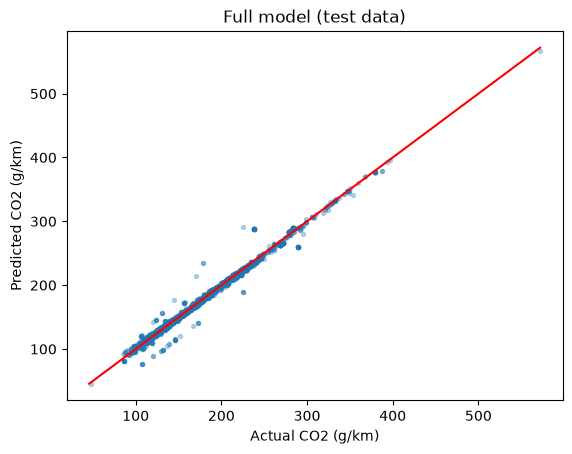
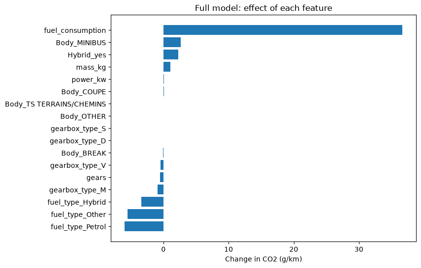

# Vehicle CO2 Emissions Predictor

Predicts a vehicle's CO2 emissions (g/km) from its power, weight, fuel type, gearbox, body style and fuel consumption using linear regression with gradient descent written from scratch (pandas, matplotlib, seaborn, scikit-learn).

  

## Team and roles

**Team no.: 47**

| Member | Entry no. | GitHub handle | Role |
|---|---|---|---|
| Ishaan Shetye | 2026MCB1568 | Ishaan-1568 | Documentation lead |
| Prit Vora | 2026AIB1097 | prit-iitrpr | Execution lead |
| Ashish Meena | 2026ESB1473 | 2026esb1472-star | PPT lead |
| Geetansh Verma | 2026EEB1351 | gtansh-08 | Video lead |

*All four members contributed code (see commit history).*

## Project structure

```
AI101-Project/
├── README.md
├── requirements.txt            # pinned library versions
├── main.py                     # entry point: runs everything, saves plots to outputs/
├── explore.py                  # (a) statistics and plots of the raw data
├── preprocess.py               # (b) cleaning, encoding, train/test split, scaling
├── train.py                    # (c) gradient descent from scratch, loss plots
├── evaluate.py                 # (d) metrics and plots for train and test data
├── data/
│   └── vehicles_co2_emissions.csv    # 44,850 rows, 25 columns
├── outputs/                    # plots + metrics.csv (created by main.py)
└── Team-47 Project.pdf         # slides (5)

```

- **Dataset:** `data/vehicles_co2_emissions.csv` (44,850 rows, 25 columns)
- **Source:** https://www.kaggle.com/datasets/hetax17/france-vehicles-co2-emission-2013.
- **Target:** `CO2(g/km)`.

## Setup

- **Python:** 3.10 to 3.14.
- **Libraries:** pinned in `requirements.txt` (`numpy`, `pandas`, `matplotlib`, `seaborn`, `scikit-learn`).

```bash
git clone https://github.com/prit-iitrpr/AI101-Project.git
cd AI101-Project
pip install -r requirements.txt
```

## How to run

1. First run command given above and then run `python main.py`
2. The script prints the statistics and the evaluation tables, and saves 11 plots and `metrics.csv` in `outputs/`.
3. Expected runtime: About 25 seconds. No internet is needed (the data is in the repo).


## Expected output

*(abridged)* console output:

```text
===== STEP 1: UNDERSTAND THE DATA =====
Shape (rows, columns): (44850, 25)
...
Duplicate rows: 0

===== STEP 2: PREPROCESSING =====
Rows removed because of missing values: 39
Rows left: 44811
Training rows: 35848 | Testing rows: 8963

===== STEP 3: TRAINING (gradient descent from scratch) =====
Learning rate 0.001 -> final loss: 0.0721
Learning rate 0.01 -> final loss: 0.0188
Learning rate 0.1 -> final loss: 0.012
Learning rate 0.3 -> final loss: 0.012
Largest weight difference vs scikit-learn: 0.00014

===== STEP 4: EVALUATION =====

FULL MODEL (uses fuel consumption)
      Training  Testing
MAE     1.7746   1.7361
MSE    18.2308  17.3562
RMSE    4.2698   4.1661
R2      0.9880   0.9886

SPECS-ONLY MODEL (no fuel consumption)
      Training   Testing
MAE    11.4272   11.4405
MSE   236.2500  239.3935
RMSE   15.3704   15.4723
R2      0.8449    0.8422
```

**Key results** (test set): the full model reaches R² = 0.988 (average error about 1.8 g/km). Without fuel consumption (specs-only model) R² = 0.833 (average error about 11.4 g/km). Training and testing scores are close, so there is no overfitting, and our gradient descent matches scikit-learn.

| Predicted vs actual (full model) | Effect of each feature |
|---|---|
|  |  |

All plots and `metrics.csv` are in [`outputs/`](outputs/).

## Links

- Slides (5): [`PPT`](Team-47%20Project.pdf)
- Video (5 Min): https://youtu.be/tVPJYkYCTBk

## AI-use disclosure

- **Claude (Anthropic):** The initial draft for the code was written by each of the teammate, AI(Claude) was used to refine and present the code in a clearer manner.
Furthermore, It was used to assist in the process of documentation which the includes the Readme file as well.
